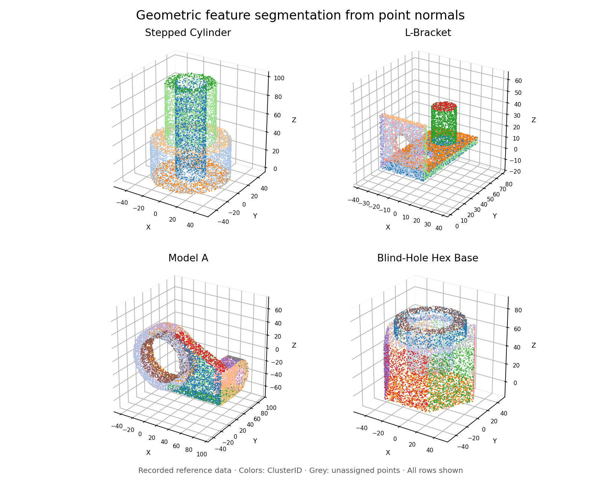
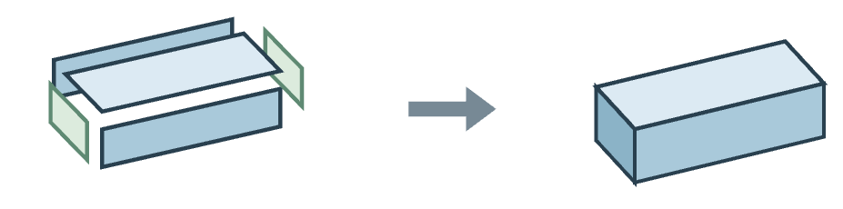
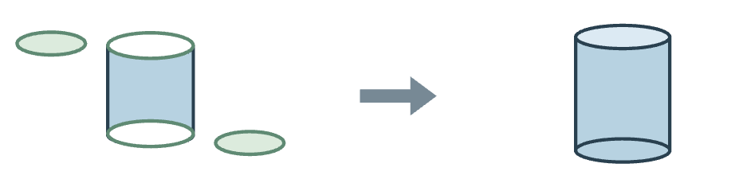
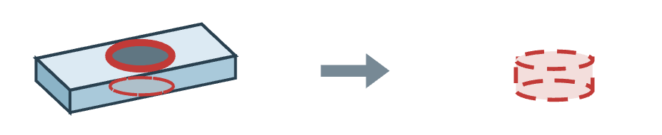
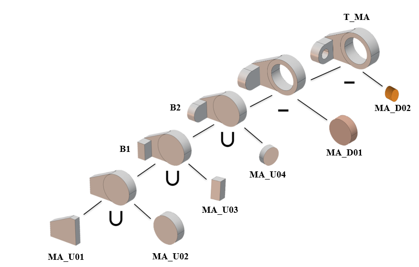
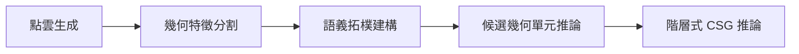

# Point Cloud to CSG Inference

[](https://github.com/YunXi503/point-cloud-csg-reconstruction/actions/workflows/verify.yml)

以 **C# 與 Python** 實作的幾何重建研究專案：從零件點雲與曲面法向量，辨識平面／圓柱面、建立拓樸關係，產生可追溯的階層式 CSG 推論表示。

Rule-based geometric inference from sampled point normals, with preserved research sources, reproducible examples, and explicit data provenance.



預覽直接讀取參考 CSV，四個範例各顯示全部 10000 點；顏色表示 ClusterID，灰色為未分類點。[圖件資料來源](assets/data-manifest.json)

作者：**黃云析 Yun-Hsi Huang**。本專案整理自碩士論文「使用曲面法向量特性與建構式實體幾何法則重塑點雲資料成為實體模型之研究」。[閱讀論文 PDF](paper/thesis-public-snapshot-20261105.pdf) · [論文版本與勘誤](paper/README.md)

## 從候選幾何單元到 CSG 樹

圖 3.7 示意如何由相關表面整理成候選幾何單元：

| 板件候選 | 圓柱候選 | 孔洞候選 |
|---|---|---|
|  |  |  |

圖 4.10 呈現模型A的階層式 CSG 推論。葉節點對應候選編號，∪ 與 − 分別表示聯集與差集。

論文圖採二元展開；前三個案例的 JSON 以清單分組保存候選，盲孔六角座則使用巢狀二元格式。[圖與 JSON 的表示對照](docs/csg-representation.md) 說明其順序及欄位。



[完整論文圖庫](docs/figures/README.md) 收錄 **22 個正式圖號與四個候選單元表**，可依分割、拓樸、候選及 CSG 樹閱讀，並連到對應 CSV／JSON：

[研究方法與概念圖](docs/figures/methods.md) · [階梯狀圓柱](docs/figures/stepped-cylinder.md) · [L型板](docs/figures/l-bracket.md) · [模型A](docs/figures/model-a.md) · [盲孔六角座](docs/figures/blind-hole-hex-base.md)

## 快速開始

已測試平台：Windows x64、Python 3.14.2。以下命令於 PowerShell 執行；bootstrap 會尋找實際 Python 安裝，建立專案 `.venv` 並安裝鎖定套件。

```powershell
git clone https://github.com/YunXi503/point-cloud-csg-reconstruction.git
cd point-cloud-csg-reconstruction
./tools/bootstrap.ps1
./.venv/Scripts/python.exe tools/verify-reproduction.py --case all --output-dir runs/first-check
```

此入口從既有初始分割 CSV 開始，執行四個範例的 Python 推論，檢查 **24 個核心輸出的 SHA-256**。成功狀態為 `pass`，輸出目錄必須尚未存在。[環境與手動安裝說明](docs/environment.md)

## 從點雲 CSV 執行完整程式路徑

安裝 Visual Studio MSBuild 與 .NET Framework 4.8 參考組件，以及 .NET SDK 8 或以上與 .NET 8 執行環境後，可從提供的點雲與法向量 CSV 開始：

```powershell
./.venv/Scripts/python.exe tools/run-from-point-cloud.py --case all --output-dir runs/point-cloud-check
```

工具將原樣 C# 演算法檔編成隔離程式庫，由命令列轉接器呼叫既有 `FeatureClassifier.Execute(input, output)`，再執行 Python 推論。原 Main 的固定桌面路徑與按鍵等待不會被呼叫；研究演算法與參數未改寫。

此路徑已在另一個含空格及中文的目錄、重新安裝的虛擬環境中通過：**4 個初始分割 CSV 與 24 個核心輸出均逐位元相符**。[實測紀錄](validation/2026-11-05/relocated-pipeline-results.json)

## 方法與輸出



本次入口從已生成的點雲與法向量 CSV 開始，涵蓋分割至推論；STL／Blender 取樣來源一併保留，尚未納入此次自動重跑。

| 階段 | 可檢查的輸出 |
|---|---|
| 幾何特徵分割與面型查驗 | 點級 ClusterID、FeatureType（依來源）、修正紀錄 |
| 語義拓樸建構 | FaceSummary、TopologyEdges |
| 候選幾何單元推論 | PrimitiveCandidates、來源群集與 BooleanType |
| 階層式 CSG 推論 | CSG 推論 JSON、候選編號及 Union／Difference 組合關係 |

| 實作範例 | 點雲→C#→Python | 既有分割 CSV→Python |
|---|---|---|
| 階梯狀圓柱 | 初始 CSV 相符；6／6 核心輸出相符 | 6／6 |
| L型板 | 初始 CSV 相符；6／6 核心輸出相符 | 6／6 |
| 模型A | 初始 CSV 相符；6／6 核心輸出相符 | 6／6 |
| 盲孔六角座 | 初始 CSV 相符；6／6 核心輸出相符 | 6／6 |

兩條路徑查驗相同四個資料範例，不能合併解讀為更多獨立實驗或準確率。初始 C# 來源以實測雜湊綁定，不能只靠目錄名判定。[實作對照](docs/architecture.md) · [查驗範圍](docs/validation.md)

## 程式與工程分工

| 位置 | 內容 |
|---|---|
| [research/](research/README.md) | 原研究演算法、模型、點雲及歷史驗證輸出 |
| [src/adapter/](src/adapter) | 新增的輸入輸出轉接與來源連結建置入口 |
| [tools/](tools) | 環境建立、執行、雜湊驗證、圖件及發布工具 |
| [examples/](examples) | 各範例的來源、輸入、環境及參考輸出綁定 |
| [tests/](tests) | 11 項錯誤偵測測試；使用軟體 fixture，非研究數據 |
| [provenance/](provenance) | 來源雜湊、版本差異、補件及輸入找回紀錄 |
| [validation/](validation) | 乾淨安裝、搬移與實測結果 |
| [archive/](archive/README.md) | 舊程式與歷史專案，供追溯使用 |

研究核心維持原樣；工程整理新增可攜入口、版本綁定、完整依賴鎖定、自動查驗及 CI。歷史 csproj 缺件保留於紀錄，現行入口使用經輸出確認的來源檔。

## 查驗與維護

```powershell
node tools/verify-package.mjs
./.venv/Scripts/python.exe -m unittest discover -s tests -v
```

[GitHub Actions](https://github.com/YunXi503/point-cloud-csg-reconstruction/actions/workflows/verify.yml) 檢查封裝、錯誤防護及兩種重現路徑。[維護說明](docs/maintaining.md) · [第二輪審查與改善](docs/second-pass-review.md)

[作品補全審查](docs/portfolio-review.md) 記錄個人分工、案例假設、品質摘要與效能量測等後續項目。

## 研究範圍

資料為 STL 網格模型生成的點雲與法向量，研究聚焦平面與圓柱面型，輸出為 **CSG 推論表示**。目前證據不涵蓋真實掃描、自由曲面、圓角、轉接曲面或一般化 CAD 實體檔輸出。

逐位元重現支持指定資料、來源及環境下的輸出一致性，不表示全文每項主張均重新驗證，亦不作方法優越性或跨模型泛化證據。

## 授權與論文

原創程式與新增專案說明採 [MIT](LICENSE)。論文 PDF、原圖與候選表保留原著作權；模型、資料及第三方套件的適用範圍見 [NOTICE](NOTICE.md)。

論文正式英文題名：*Constructing Solid Model from Point Cloud via Surface Normal and CSG Rules*。
