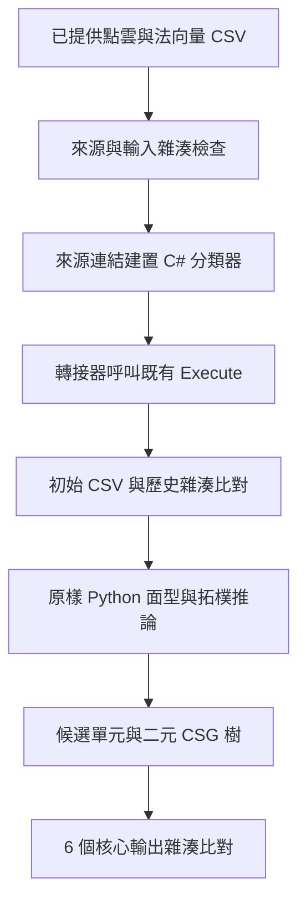

# 程式路徑與來源分工

新增部分為工程入口、來源綁定及查驗工具。研究 C#／Python 演算法保留原位元，不重新實作成另一套方法。

較短入口直接從已記錄的初始分割 CSV 開始。兩條入口查驗相同四個範例，不能當成更多獨立研究樣本。

## 確認的 C# 來源

| 範例 | 來源識別 | 依據 |
|---|---|---|
| 階梯狀圓柱 | Stepped Cylinder 目錄現存同名 .cs | 新來源連結入口能重現；不冒充原 csproj 缺失的 Program.cs |
| L型板 | L_Bracket幾何邏輯內的 L-Bracket 幾何邏輯.cs | 此版可重現；基本分割器另有 298 個群集標籤不同 |
| 模型A | Model A 目錄同名 .cs | 初始 CSV 與後續輸出皆逐位元相符 |
| 盲孔六角座 | 原有修正版 .cs，在 .NET 8 執行 | 初始與後續輸出相符；另一 runtime 的差異另留紀錄 |

檔名、雜湊與環境見 [segmentation.json](../examples/segmentation.json)。目錄名稱本身不是版本證據。

L型板既有分類器會寫出額外面與候選資料；本入口只將其初始 CSV 傳給 Python，不讀那些額外資料。獨立 STL／網格參考只供驗證，不作已知幾何真值輸入。

## 方法範圍

初始 C# 分類器包含各範例既有規則及常數，Python 做後續面型查驗、拓樸與 CSG 推論。檔案重現不等同證明舊分類器的內部規則均與論文共通敘述逐條一致，亦不建立新泛化主張。

本輪未做內部參數消融，不將整個來源版本的輸出差異歸因到單一門檻。研究方法若修改，仍須另行對照研究計畫與紀錄。

## 轉接器

src/adapter/ 以來源連結編譯單一研究檔，尋找唯一公開 FeatureClassifier.Execute(string, string)，只傳入輸入與輸出路徑。不設定分類器欄位或門檻，不呼叫固定桌面路徑的 Main，拒絕覆寫既有輸出。

原始碼、編譯產物及輸出分離；產物位於指定的新 runs/ 目錄，模型與歷史參考維持原位元。
