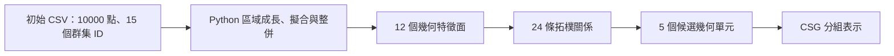

# L型板：從點雲到候選與 CSG 的程式導讀

[面試官閱讀入口](interview-guide.md) · [機器可讀數值與 SHA](../provenance/interview-evidence.json) · [L型板論文圖件](figures/l-bracket.md)

LB_D01與BH_D01的端部、深度及兩份實作差異，另見[貫穿孔／盲孔判別導讀](hole-end-conditions.md)。

這是一個保存資料的逐層導讀，沒有新增研究實驗。以下數值直接取自本庫初始 CSV、已驗證輸出與原程式，不把指定零件的規則當成通用辨識器。



## 1. 輸入與初始分類

完整入口使用[點雲／來源綁定](../examples/segmentation.json)中的 C# 幾何邏輯版，取得[初始分割 CSV](../research/%E9%9B%B6%E4%BB%B6/Result_L%20Bracket.csv)；其欄位為 X、Y、Z、NX、NY、NZ、ClusterID，沒有 FeatureType。

檢視保存資料可見：初始 10000 列、15 個群集 ID；Python 結果仍為 10000 列，整理為 12 個幾何特徵面、殘留點 0。這是現存 CSV 的統計，不能將點數守恆解讀為分割正確率。

## 2. 幾何處理與資料結構

從 [build_outputs](../research/tools/infer_lbracket_chapter3_method.py#L499) 進入，點位置與法向量各為 N×3 陣列；讀入的 ClusterID 用於後續追溯。

1. [region_growing](../research/tools/infer_lbracket_chapter3_method.py#L52) 用 cKDTree 找距離 2.0 mm 內的點對，以法向量內積至少 0.93 篩選，建立稀疏無向圖，再以 connected_components 形成初始分量。這段 Python 使用圖連通分量，並沒有在此函式中實作佇列式區域成長。
2. [fit_component](../research/tools/infer_lbracket_chapter3_method.py#L69) 先試平面，再試圓柱；使用[原輔助程式](../research/tools/correct_stepped_cylinder_nls_v2.py#L76)的 SVD、投影圓擬合及殘差／法向量條件。最大殘差與最小法向量一致性須同時通過。
3. [merge_surface_components](../research/tools/infer_lbracket_chapter3_method.py#L117) 以平面／圓柱的一致性與有限支撐範圍整併；parent 字典保存合併集合並作路徑壓縮，再嘗試將未歸屬點分派到可接受曲面。
4. [assign_cluster_ids](../research/tools/infer_lbracket_chapter3_method.py#L228) 依原群集票數與唯一 ID 條件保存追溯；[semantic_roles](../research/tools/infer_lbracket_chapter3_method.py#L260) 再依本例方向、位置及內外法向量判斷角色。12 面與角色條件不符時會停止。

[FaceSummary](../research/%E7%A2%A9%E5%A3%AB%E8%AB%96%E6%96%87/%E7%AC%AC%E5%9B%9B%E7%AB%A0%E9%A9%97%E8%AD%89%E7%B5%90%E6%9E%9C_260722/L_Bracket_chapter3_verified_v3/FaceSummary_L_Bracket_chapter3_verified.csv)保存面型、角色、點數、參數及擬合驗收；[CorrectionTrace](../research/%E7%A2%A9%E5%A3%AB%E8%AB%96%E6%96%87/%E7%AC%AC%E5%9B%9B%E7%AB%A0%E9%A9%97%E8%AD%89%E7%B5%90%E6%9E%9C_260722/L_Bracket_chapter3_verified_v3/CorrectionTrace_L_Bracket_chapter3.csv)保存原群集到驗證群集的映射。不要把初始 C# 分割、Python 的重新分群與角色判斷混成一個步驟。

## 3. 面與拓樸如何支持一個孔洞候選

[build_topology](../research/tools/infer_lbracket_chapter3_method.py#L321)逐面組比較有限點集距離與方向，依端面、正交、一般相鄰的規則記錄單一關係。本例[拓樸 CSV](../research/%E7%A2%A9%E5%A3%AB%E8%AB%96%E6%96%87/%E7%AC%AC%E5%9B%9B%E7%AB%A0%E9%A9%97%E8%AD%89%E7%B5%90%E6%9E%9C_260722/L_Bracket_chapter3_verified_v3/TopologyEdges_L_Bracket_chapter3_verified.csv)有 24 條關係：18 條 OrthogonalAdjacency、6 條 EndCap。

以 LB_D01 底板孔為例：

| 保存資料 | 實際值與解讀 |
|---|---|
| ClusterID 9 | 圓柱面；SemanticRole=base_hole；184 點 |
| ClusterID 0／2 | base_bottom／base_top，即底板下／上表面 |
| 0–9 的 EndCap | 最小取樣距離 0.514264767 mm，方向內積絕對值 1.000000000 |
| 2–9 的 EndCap | 最小取樣距離 0.389632118 mm，方向內積絕對值 1.000000000 |
| 候選來源 | RelatedClusters=0;2;9，必須找到兩個端面；方向內積 >0.95、距離 ≤5.0 mm |
| 幾何參數 | Radius=7.970796954 mm；Depth=4.999999993 mm，深度來自兩端面形心沿圓柱軸的投影差 |
| 布林角色 | 依內側法向量及已判定的 base_hole 角色，記為 Difference；只有端面相鄰本身不足以判定孔洞 |

可由 [build_candidates](../research/tools/infer_lbracket_chapter3_method.py#L391) 回查尺寸、來源面、圖連通檢查與布林角色。兩塊板件使用各自來源面的連通子圖；graph_connected 以集合、鄰接表與 deque 查驗，沒有在此呼叫 CAD 幾何核心。

## 4. 五個候選如何形成 CSG 表示

下表直接取自[候選 CSV](../research/%E7%A2%A9%E5%A3%AB%E8%AB%96%E6%96%87/%E7%AC%AC%E5%9B%9B%E7%AB%A0%E9%A9%97%E8%AD%89%E7%B5%90%E6%9E%9C_260722/L_Bracket_chapter3_verified_v3/PrimitiveCandidates_L_Bracket_chapter3_verified.csv)；空白欄位以「—」顯示，不補成零。

| CandidateID | PrimitiveType | RelatedClusters | BooleanType | Radius（mm） | Depth（mm） |
|---|---|---|---|---:|---:|
| LB_D01 | BasePlateHole | 0;2;9 | Difference | 7.970796954 | 4.999999993 |
| LB_D02 | UprightPlateHole | 1;7;11 | Difference | 7.971960387 | 5.000000002 |
| LB_U01 | BasePlate | 0;1;2;5;8;10 | Union | — | — |
| LB_U02 | UprightPlate | 1;3;5;7;8 | Union | — | — |
| LB_U03 | Cylinder | 2;4;6 | Union | 9.967792777 | 30.000000022 |

[canonical_csg_tree](../research/tools/infer_lbracket_chapter3_method.py#L489)把聯集與差集候選分組並依 CandidateID 排序。[保存的 JSON](../research/%E7%A2%A9%E5%A3%AB%E8%AB%96%E6%96%87/%E7%AC%AC%E5%9B%9B%E7%AB%A0%E9%A9%97%E8%AD%89%E7%B5%90%E6%9E%9C_260722/L_Bracket_chapter3_verified_v3/CSGTree_L_Bracket_chapter3_verified.json)是 base／children／subtractors 格式；論文的二元閱讀展開可寫成：

```text
B1 = Union(LB_U01, LB_U02)
B2 = Union(B1, LB_U03)
C1 = Difference(B2, LB_D01)
T  = Difference(C1, LB_D02)
```

以上 B1 等名稱只是閱讀用中間名稱，沒有宣稱 JSON 已輸出這些二元節點，也沒有宣稱已完成可編輯 CAD 實體。[表示契約](csg-representation.md)詳列格式差異。

## 5. 面試時如何證明這段說明

從本頁的候選 ID 回查 RelatedClusters，再查 FaceSummary 與 TopologyEdges；檔案 SHA、數值及來源位置都在 interview-evidence.json。若執行原方法，使用 README 的既有入口與新 runs/ 目錄，逐檔核對六項核心輸出。

既有[品質結果](results.md)另提供相對獨立幾何參考的尺寸誤差。來源一致、點數守恆、拓樸規則通過及幾何品質是不同證據；不能互相代替。
