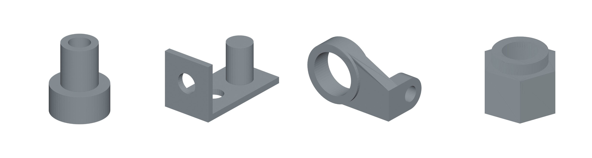
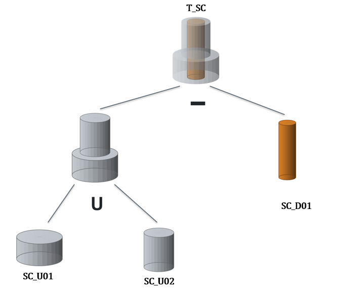
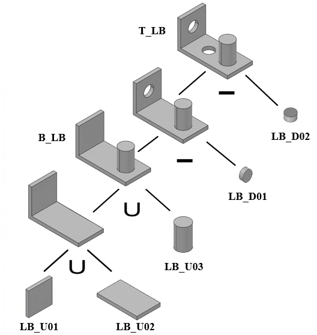
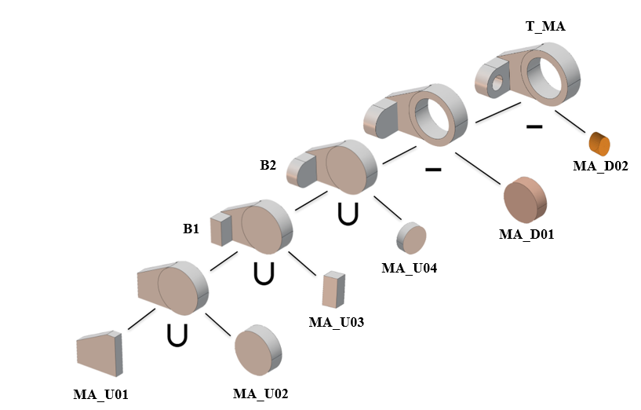
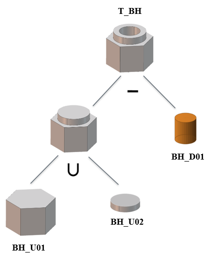

# 論文圖庫

[專案首頁](../../README.md) · [完整論文 PDF](../../paper/thesis-public-snapshot-20261105.pdf) · [圖件來源與雜湊](../../provenance/thesis-figures.json)

收錄目前公開論文的 **22 個正式圖號、28 張原始內嵌 PNG**，以及 **4 張候選幾何單元查驗表**。方法與四個案例分頁呈現，可直接檢視原圖、候選資料與 CSG 樹。

| 入口 | 內容 |
|---|---|
| [研究方法與概念圖](methods.md) | 圖 3.1–3.9：點雲、分割、拓樸、候選單元及 CSG 概念 |
| [階梯狀圓柱](stepped-cylinder.md) | 圖 4.2–4.4、表 4.6；共軸圓柱、端面關係與中央貫穿孔 |
| [L型板](l-bracket.md) | 圖 4.5–4.7、表 4.7；正交板件、圓柱凸台與不同方向的孔洞 |
| [模型A](model-a.md) | 圖 4.8–4.10、表 4.8；多軸圓柱、剖面擠出候選與多層聯集／差集 |
| [盲孔六角座](blind-hole-hex-base.md) | 圖 4.11–4.13、表 4.9；六角基座、環台與具有有限深度的盲孔 |

## 圖 4.1 本研究之實作範例示意圖

[開啟原圖](../../assets/thesis/fig-4-1.png) · 論文正文第 31 頁／PDF 第 42 頁

由左至右為階梯狀圓柱、L型板、模型A與盲孔六角座。

## 四個案例的 CSG 樹

點選圖片可開啟原尺寸；上方案例入口可接著查看其拓樸圖與候選表。

| 階梯狀圓柱 | L型板 |
|---|---|
|  |  |

| 模型A | 盲孔六角座 |
|---|---|
|  |  |

## 圖件版本與範圍

CSG 圖以二元樹呈現；前三例 JSON 為候選分組格式，盲孔六角座 JSON 為巢狀二元格式。欄位及展開順序見[圖與 JSON 的表示對照](../csg-representation.md)。

圖號與圖名依 260811 Word 現存版本及已公開 PDF 核對，使用其實際內嵌圖片，避免混入較早版本的圖號。原始 PNG 逐位元保存；Word 版面的裁切設定另記在來源清單，圖庫展示完整圖片。候選表直接從同一 PDF 匯出，數值未重算或重寫。

資料為 STL 模型生成的點雲與法向量，圖中幾何為研究推論示意。該版只增加圖庫與文件導覽；程式、參數、研究資料及原論文保持不變。論文圖件與表格保留原著作權，適用範圍見 [NOTICE](../../NOTICE.md)。
