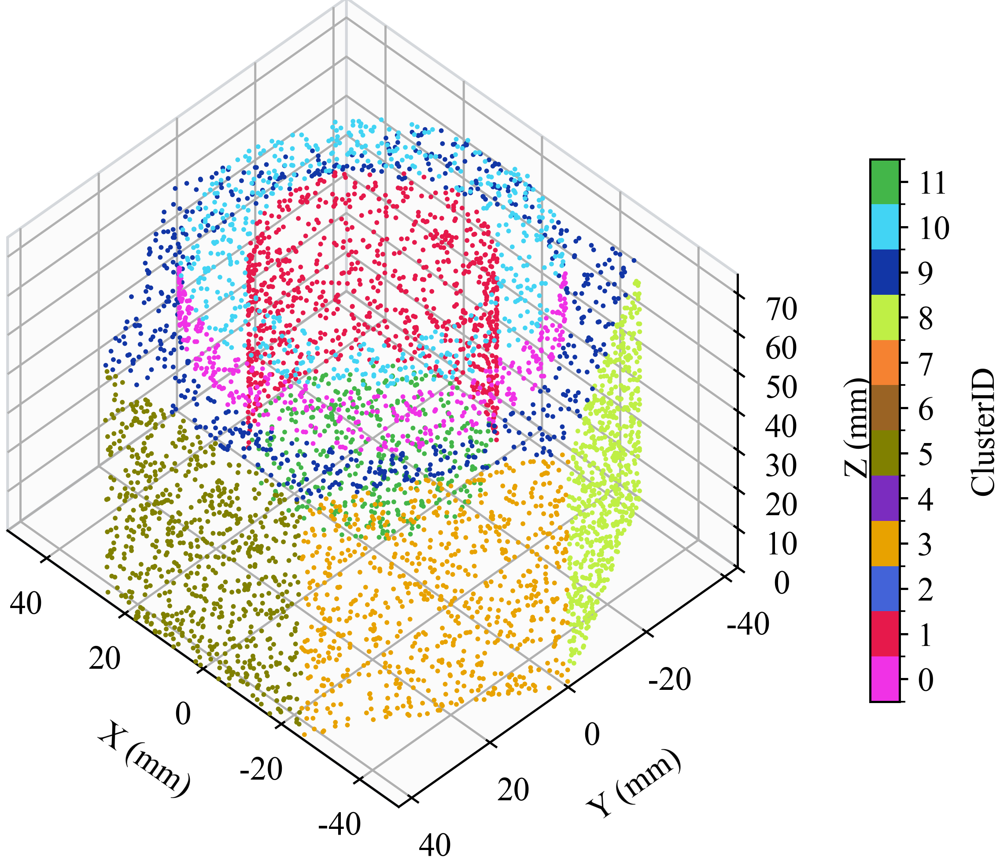
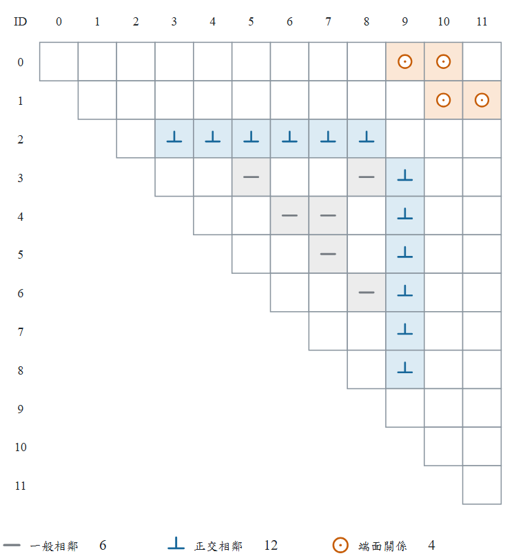
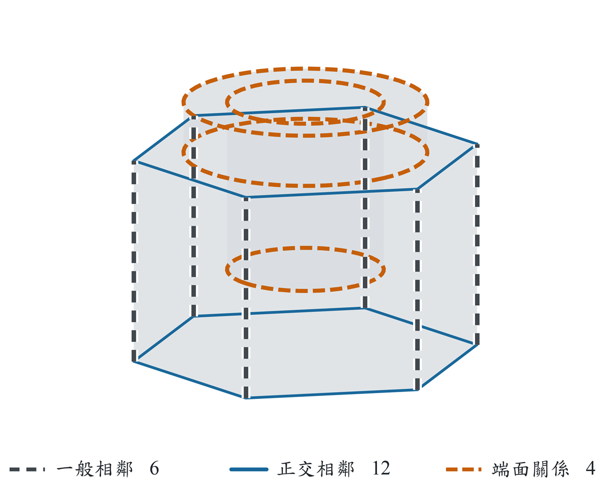
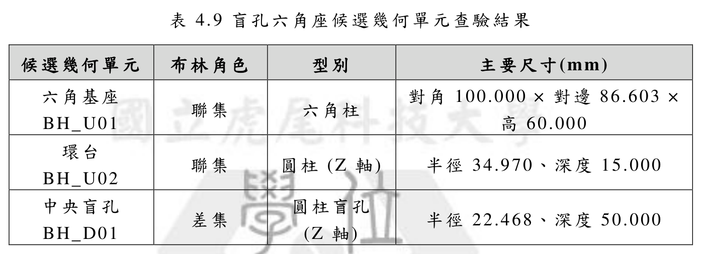
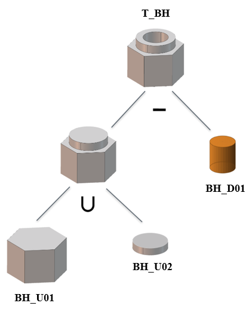

# 盲孔六角座：從分割到 CSG 推論

[回圖庫](README.md) · [專案首頁](../../README.md) · [完整論文 PDF](../../paper/thesis-public-snapshot-20261105.pdf)

閱讀重點：六角基座、環台與具有有限深度的盲孔。以下沿用原論文圖號與候選編號，依分割、拓樸、候選單元及 CSG 樹順序閱讀。

## 圖 4.11 盲孔六角座驗證後幾何特徵分割結果

[開啟原圖](../../assets/thesis/fig-4-11.png) · 論文正文第 47 頁／PDF 第 58 頁

## 圖 4.12 盲孔六角座拓樸關係

(a) 拓樸關係矩陣

(b) 拓樸關係空間圖

[開啟原圖](../../assets/thesis/fig-4-12a.png) · 論文正文第 48 頁／PDF 第 59 頁

## 表 4.9 盲孔六角座候選幾何單元查驗結果

此圖直接由公開 PDF 的表格區域匯出，保留原表題、數值及浮水印。正文第 49 頁／PDF 第 60 頁。

檢視表格文字（原論文顯示精度）

| 候選幾何單元 | 布林角色 | 型別 | 主要尺寸(mm) |
|---|---|---|---|
| 六角基座 BH_U01 | 聯集 | 六角柱 | 對角 100.000 × 對邊 86.603 × 高 60.000 |
| 環台 / BH_U02 | 聯集 | 圓柱 (Z 軸) | 半徑 34.970、深度 15.000 |
| 中央盲孔 BH_D01 | 差集 | 圓柱盲孔 / (Z 軸) | 半徑 22.468、深度 50.000 |

## 圖 4.13 盲孔六角座階層式 CSG 推論

[開啟原圖](../../assets/thesis/fig-4-13.png) · 論文正文第 49 頁／PDF 第 60 頁

CSG 樹中的葉節點呈現候選單元，∪ 與 − 分別表示聯集與差集；圖示呈現論文中的推論與建構關係。軟體輸出範圍為可追溯的 CSG 推論表示。

## 對照程式輸出

- [幾何特徵面 CSV](../../research/%E7%A2%A9%E5%A3%AB%E8%AB%96%E6%96%87/%E7%AC%AC%E5%9B%9B%E7%AB%A0%E9%A9%97%E8%AD%89%E7%B5%90%E6%9E%9C_260725/Blind_Hole_Hex_Base_chapter3_verified_v3/FaceSummary_Blind_Hole_Hex_Base_chapter3_verified.csv)
- [拓樸關係 CSV](../../research/%E7%A2%A9%E5%A3%AB%E8%AB%96%E6%96%87/%E7%AC%AC%E5%9B%9B%E7%AB%A0%E9%A9%97%E8%AD%89%E7%B5%90%E6%9E%9C_260725/Blind_Hole_Hex_Base_chapter3_verified_v3/TopologyEdges_Blind_Hole_Hex_Base_chapter3_verified.csv)
- [候選幾何單元 CSV](../../research/%E7%A2%A9%E5%A3%AB%E8%AB%96%E6%96%87/%E7%AC%AC%E5%9B%9B%E7%AB%A0%E9%A9%97%E8%AD%89%E7%B5%90%E6%9E%9C_260725/Blind_Hole_Hex_Base_chapter3_verified_v3/PrimitiveCandidates_Blind_Hole_Hex_Base_chapter3_verified.csv)
- [CSG 樹 JSON](../../research/%E7%A2%A9%E5%A3%AB%E8%AB%96%E6%96%87/%E7%AC%AC%E5%9B%9B%E7%AB%A0%E9%A9%97%E8%AD%89%E7%B5%90%E6%9E%9C_260725/Blind_Hole_Hex_Base_chapter3_verified_v3/CSGTree_Blind_Hole_Hex_Base_chapter3_verified.json)

論文表格保留正文的顯示精度；CSV 保留既有輸出欄位及數值。圖表公開不新增研究驗證或跨模型泛化主張。
