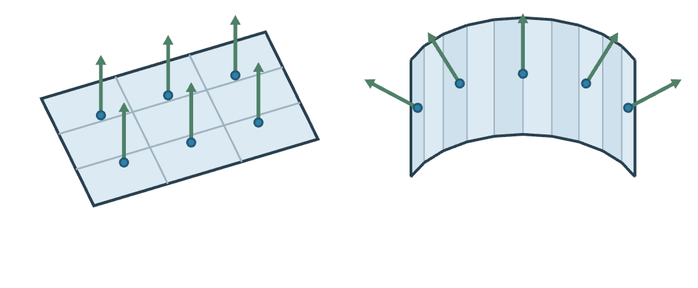
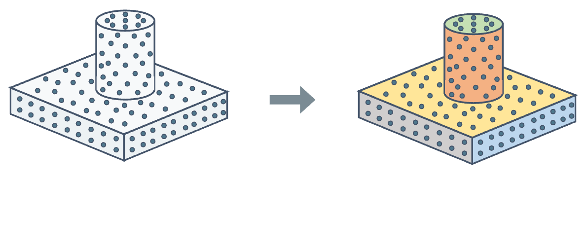
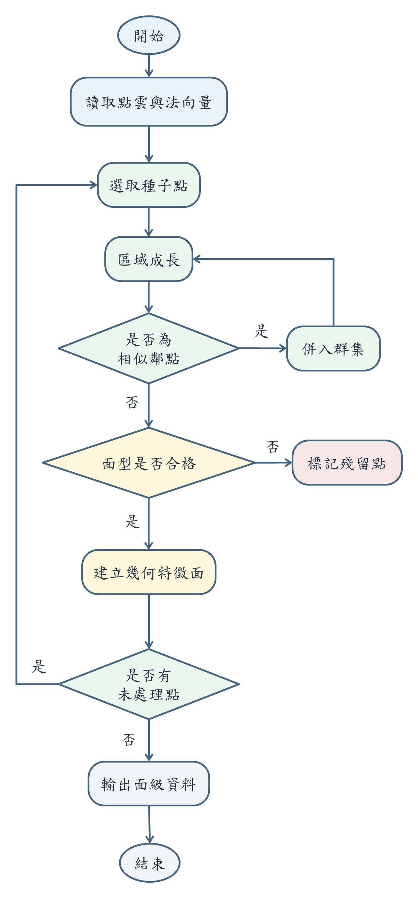
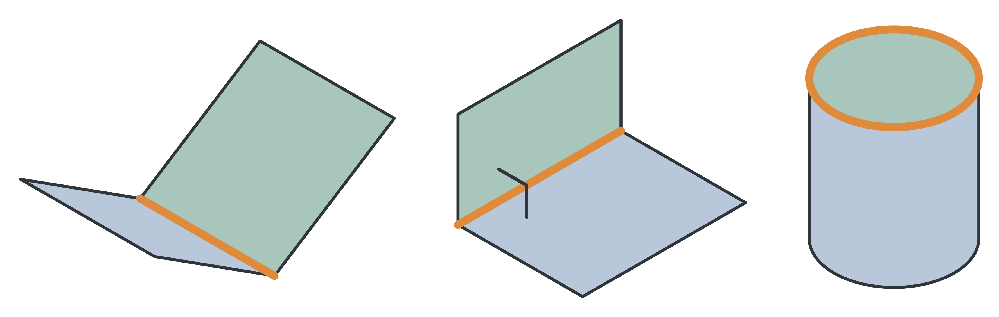
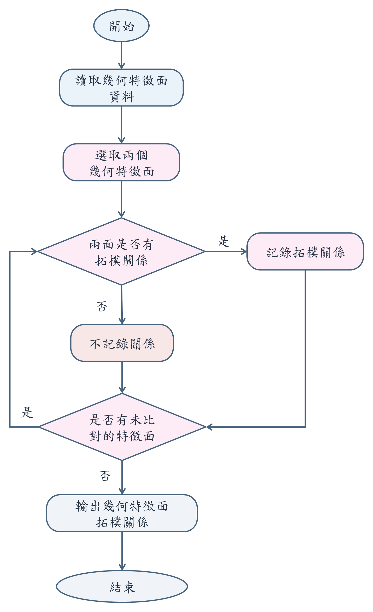
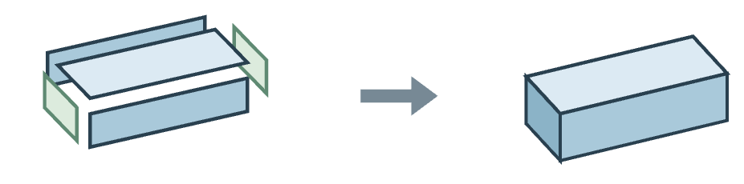
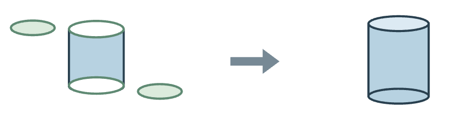
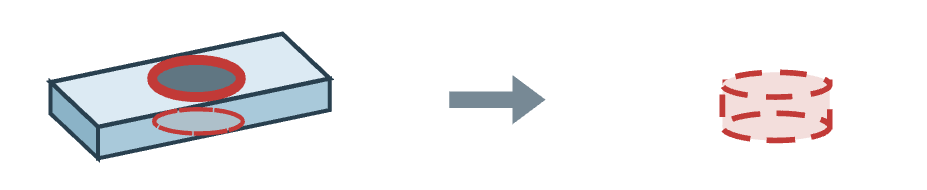
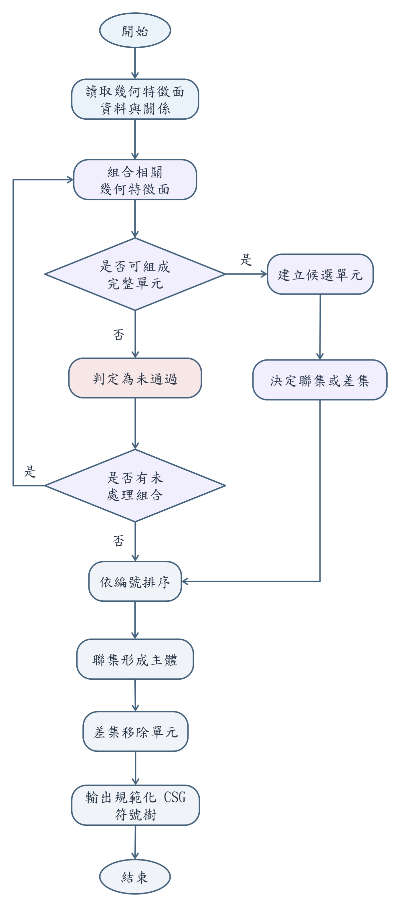
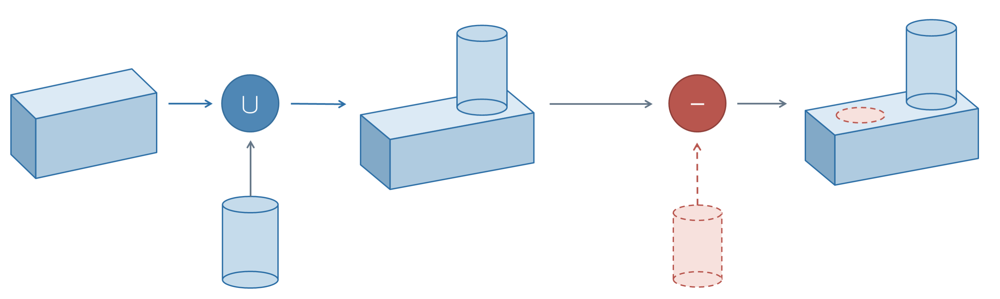

# 方法圖與概念圖

[回圖庫](README.md) · [專案首頁](../../README.md) · [完整論文 PDF](../../paper/thesis-public-snapshot-20261105.pdf)

依目前公開論文圖 3.1 至圖 3.9 的順序排列。原始 PNG 保留完整內嵌圖片，子圖名稱補在圖片外；正式版面的裁切、字體及圖表配置可回 PDF 查對。

## 圖 3.1 研究方法流程圖

[開啟原圖](../../assets/thesis/fig-3-1.png) · 論文正文第 14 頁／PDF 第 25 頁

## 圖 3.2 點雲樣本與曲面法向量資料結構示意圖

由左至右為 (a) 平面取樣點與法向量、(b) 曲面取樣點與法向量。

[開啟原圖](../../assets/thesis/fig-3-2.png) · 論文正文第 16 頁／PDF 第 27 頁

## 圖 3.3 特徵分割概念示意圖

由左至右為 (a) 分割前點雲、(b) 分割後群集。

[開啟原圖](../../assets/thesis/fig-3-3.png) · 論文正文第 17 頁／PDF 第 28 頁

## 圖 3.4 幾何特徵分割與幾何特徵面建構流程圖

[開啟原圖](../../assets/thesis/fig-3-4.png) · 論文正文第 19 頁／PDF 第 30 頁

## 圖 3.5 三種拓樸關係概念示意圖

原程式的分支優先順序、距離／方向條件及三筆實際面組，見[拓樸規則例解](../topology-rules.md)。

由左至右為 (a) 一般相鄰、(b) 正交相鄰、(c) 端面關係。

[開啟原圖](../../assets/thesis/fig-3-5.png) · 論文正文第 22 頁／PDF 第 33 頁

## 圖 3.6 幾何特徵面拓樸關係建構流程圖

[開啟原圖](../../assets/thesis/fig-3-6.png) · 論文正文第 24 頁／PDF 第 35 頁

## 圖 3.7 候選幾何單元推論概念示意圖

(a) 板件候選

(b) 圓柱候選

(c) 孔洞候選

[開啟原圖](../../assets/thesis/fig-3-7a.png) · 論文正文第 25 頁／PDF 第 36 頁

## 圖 3.8 候選幾何單元與階層式 CSG 推論流程圖

[開啟原圖](../../assets/thesis/fig-3-8.png) · 論文正文第 27 頁／PDF 第 38 頁

## 圖 3.9 階層式 CSG 推論概念示意圖

[開啟原圖](../../assets/thesis/fig-3-9.png) · 論文正文第 28 頁／PDF 第 39 頁

圖 3.7 說明由表面整理出候選幾何單元；圖 3.8、圖 3.9 接續說明推論流程與布林建構關係。這些概念圖的形狀不作新增實驗結果。
