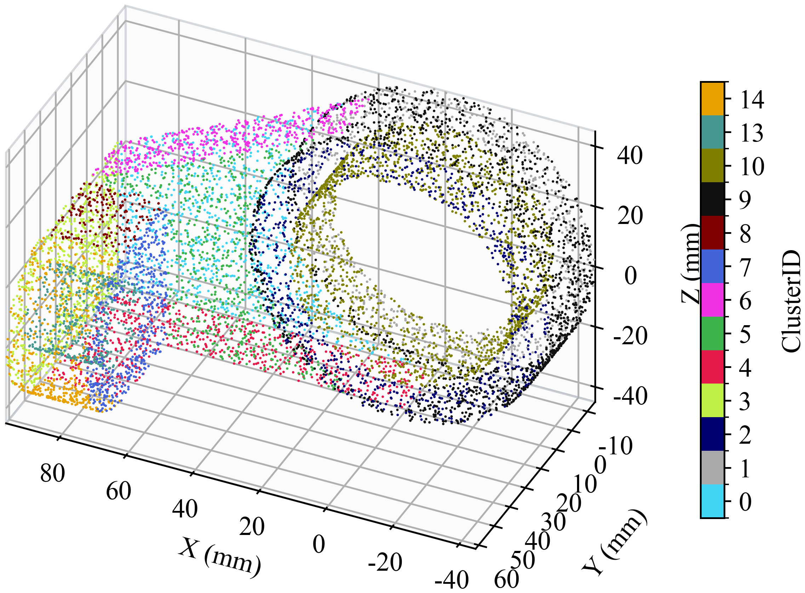
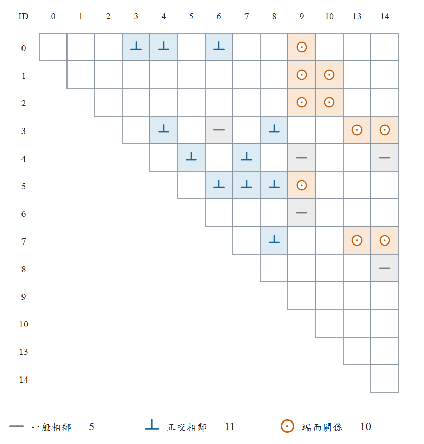
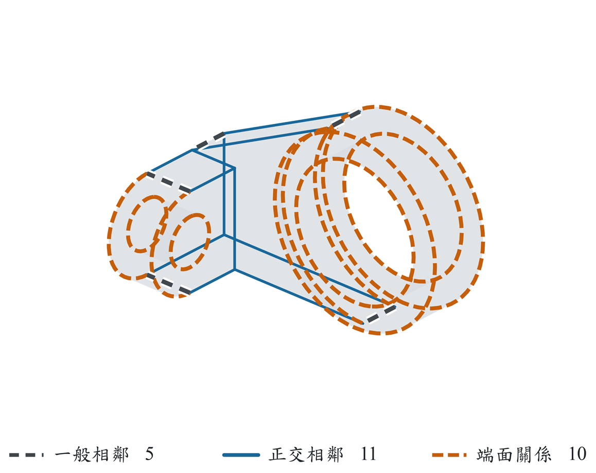
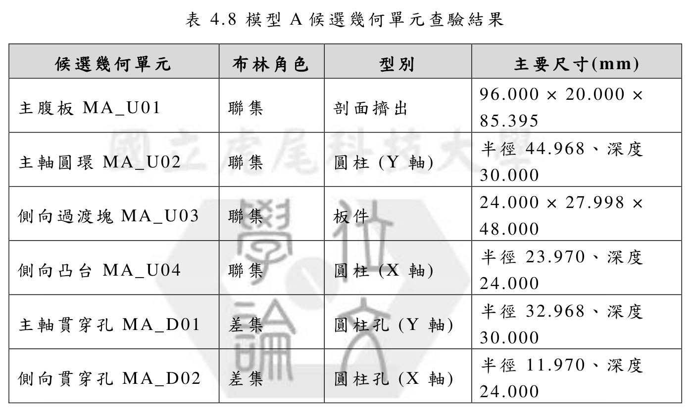
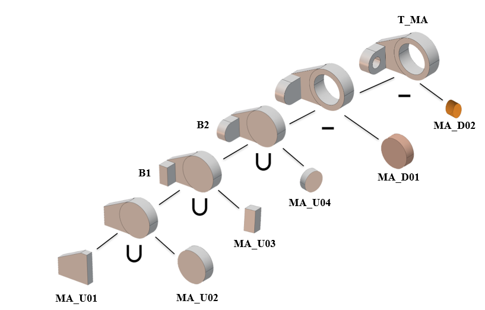

# 模型A：從分割到 CSG 推論

[回圖庫](README.md) · [專案首頁](../../README.md) · [完整論文 PDF](../../paper/thesis-public-snapshot-20261105.pdf)

閱讀重點：多軸圓柱、剖面擠出候選與多層聯集／差集。以下沿用原論文圖號與候選編號，依分割、拓樸、候選單元及 CSG 樹順序閱讀。

## 圖 4.8 模型A驗證後幾何特徵分割結果

[開啟原圖](../../assets/thesis/fig-4-8.png) · 論文正文第 43 頁／PDF 第 54 頁

## 圖 4.9 模型A拓樸關係

(a) 拓樸關係矩陣

(b) 拓樸關係空間圖

[開啟原圖](../../assets/thesis/fig-4-9a.png) · 論文正文第 44 頁／PDF 第 55 頁

## 表 4.8 模型A候選幾何單元查驗結果

此圖直接由公開 PDF 的表格區域匯出，保留原表題、數值及浮水印。正文第 45 頁／PDF 第 56 頁。

檢視表格文字（原論文顯示精度）

| 候選幾何單元 | 布林角色 | 型別 | 主要尺寸(mm) |
|---|---|---|---|
| 主腹板 MA_U01 | 聯集 | 剖面擠出 | 96.000 × 20.000 × 85.395 |
| 主軸圓環 MA_U02 | 聯集 | 圓柱 (Y 軸) | 半徑 44.968、深度 30.000 |
| 側向過渡塊MA_U03 | 聯集 | 板件 | 24.000 × 27.998 × 48.000 |
| 側向凸台 MA_U04 | 聯集 | 圓柱 (X 軸) | 半徑 23.970、深度 24.000 |
| 主軸貫穿孔 MA_D01 | 差集 | 圓柱孔 (Y 軸) | 半徑 32.968、深度 30.000 |
| 側向貫穿孔 MA_D02 | 差集 | 圓柱孔 (X 軸) | 半徑 11.970、深度 24.000 |

## 圖 4.10 模型A階層式 CSG 推論

[開啟原圖](../../assets/thesis/fig-4-10.png) · 論文正文第 46 頁／PDF 第 57 頁

CSG 樹中的葉節點呈現候選單元，∪ 與 − 分別表示聯集與差集；圖示呈現論文中的推論與建構關係。軟體輸出範圍為可追溯的 CSG 推論表示。

## 對照程式輸出

- [幾何特徵面 CSV](../../research/%E7%A2%A9%E5%A3%AB%E8%AB%96%E6%96%87/%E7%AC%AC%E5%9B%9B%E7%AB%A0%E9%A9%97%E8%AD%89%E7%B5%90%E6%9E%9C_260724/Model_A_chapter3_verified_v3/FaceSummary_Model_A_chapter3_verified.csv)
- [拓樸關係 CSV](../../research/%E7%A2%A9%E5%A3%AB%E8%AB%96%E6%96%87/%E7%AC%AC%E5%9B%9B%E7%AB%A0%E9%A9%97%E8%AD%89%E7%B5%90%E6%9E%9C_260724/Model_A_chapter3_verified_v3/TopologyEdges_Model_A_chapter3_verified.csv)
- [候選幾何單元 CSV](../../research/%E7%A2%A9%E5%A3%AB%E8%AB%96%E6%96%87/%E7%AC%AC%E5%9B%9B%E7%AB%A0%E9%A9%97%E8%AD%89%E7%B5%90%E6%9E%9C_260724/Model_A_chapter3_verified_v3/PrimitiveCandidates_Model_A_chapter3_verified.csv)
- [CSG 樹 JSON](../../research/%E7%A2%A9%E5%A3%AB%E8%AB%96%E6%96%87/%E7%AC%AC%E5%9B%9B%E7%AB%A0%E9%A9%97%E8%AD%89%E7%B5%90%E6%9E%9C_260724/Model_A_chapter3_verified_v3/CSGTree_Model_A_chapter3_verified.json)

論文表格保留正文的顯示精度；CSV 保留既有輸出欄位及數值。圖表公開不新增研究驗證或跨模型泛化主張。
