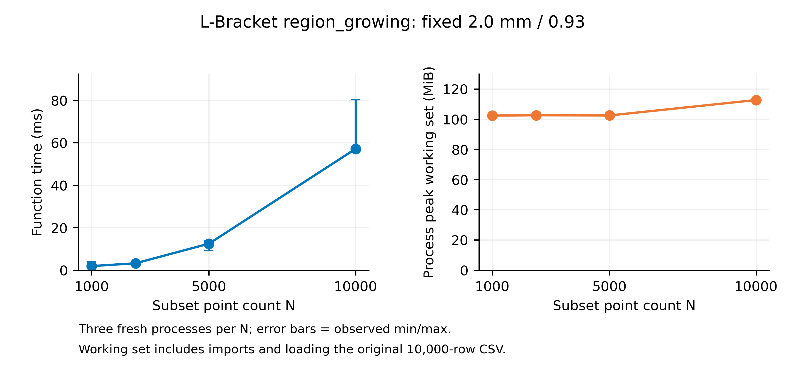

# 既有案例的時間、記憶體與函式規模量測

[首頁](../README.md) · [事前協定](measurement-protocol.md) · [原始 JSON](../validation/2026-11-05/measurement-results.json) · [統計摘要](../validation/2026-11-05/measurement-summary.json) · [幾何診斷](geometry-diagnostics.md) · [再次審查](measurement-review.md)

日期：2026-11-05。依 v0.1.5 的原研究來源及參數執行，四案例各 10000 點。共 24 次階段量測，84 項初始／核心輸出雜湊全部與原參考相符；沒有改期望 SHA 或把新數字回填正式論文。

## 環境與數字意義

本機 Intel Xeon w3-2435，8 核心／16 邏輯處理器；Windows 11 工作站版 10.0.26300；實體記憶體 137060847616 bytes。Python 3.14.2 與原 13 套件完整鎖定環境已核對；C# 依原案例使用 .NET Framework 4.8 或 .NET 8。原始 JSON 保存實際 runtime、硬體、版本、輸入綁定及工具 SHA。

所有受測程序依序執行，沒有強制變更 BLAS／OMP 等執行緒環境變數；這不代表數值函式只用一個執行緒。背景負載、CPU 動態頻率與檔案快取未隔離。先前準備與編譯可能暖化快取，不是冷機測試。

- 時間為受測單一程序建立至結束的 wall time；輸出雜湊驗證不在計時內。C# 分類不含編譯；Python 推論 CLI 包含啟動、匯入、CSV 讀寫及推論。
- 記憶體為 Windows 原生 PeakWorkingSetSize，除以 1048576 顯示 MiB；包含 runtime／套件與資料，沒有扣掉起始值，不是函式獨占配置量或程序樹峰值。[Microsoft 欄位定義](https://learn.microsoft.com/en-us/windows/win32/api/psapi/ns-psapi-process_memory_counters)
- 每組三個新程序。表中為中位數（最小–最大），不是信賴區間，不用三次試驗宣稱效能優越性，也不將不同工作量的 C#／Python 階段當成語言效能比較。

Windows venv 啟動器可能另開真正的 runtime。本工具直接啟動 `sys._base_executable`，用 `__PYVENV_LAUNCHER__` 保留原虛擬環境，先驗證 PID、prefix、套件與 64 MiB 配置探針。事前協定保持收集時的原位元；其中該識別字在 Markdown 顯示為粗體，完整前後雙底線以本段程式識別字及[工具來源](../tools/process_metrics.py)為準。

## 四案例的兩個階段

| 案例 | 量測階段 | 程序時間（秒） | 程序峰值工作集（MiB） |
|---|---|---:|---:|
| 階梯狀圓柱 | C# 分類 | 6.802（6.772–6.814） | 25.16（25.13–25.23） |
| L型板 | C# 分類 | 6.827（6.767–6.883） | 26.00（25.99–26.05） |
| 模型A | C# 分類 | 0.201（0.187–0.210） | 28.06（28.03–28.10） |
| 盲孔六角座 | C# 分類 | 0.412（0.365–0.471） | 44.93（44.92–44.94） |
| 階梯狀圓柱 | Python 推論 CLI | 1.327（1.236–1.408） | 102.91（102.75–103.18） |
| L型板 | Python 推論 CLI | 1.463（1.427–1.546） | 116.38（116.28–116.55） |
| 模型A | Python 推論 CLI | 1.376（1.313–1.423） | 104.21（104.18–104.46） |
| 盲孔六角座 | Python 推論 CLI | 1.290（1.194–1.340） | 102.39（102.37–102.41） |

[逐次 CSV](../validation/2026-11-05/measurement-stage-runs.csv)保留未四捨五入數值。這些是本機、這些來源與這些資料的觀察；不是任意模型或其他硬體的承諾。階段分開量測，沒有把兩個中位數相加冒充完整入口含編譯的實測時間。

## 函式規模：L型板 region_growing

只變既有點集子集的 N，固定抽樣 seed=42、距離 2.0 mm 及法向量內積 0.93；每個 N 重複三次。資料索引、座標／法向量及回傳標籤 SHA 在同一 N 內全部一致。M 由獨立查核程序先計數，不進入受測函式的時間或記憶體；M 尚未經法向量篩選。

| N | 距離內點對 M | 初始連通分量 | 函式時間（ms） | 程序峰值工作集（MiB） |
|---:|---:|---:|---:|---:|
| 1000 | 518 | 620 | 1.8878（1.5030–3.8272） | 102.37（102.34–102.73） |
| 2500 | 3222 | 692 | 3.2244（3.2235–3.3543） | 102.60（102.45–102.73） |
| 5000 | 12693 | 239 | 12.4506（9.2577–13.7994） | 102.48（102.09–102.52） |
| 10000 | 50958 | 20 | 57.1184（56.8367–80.3305） | 112.69（112.57–112.99） |



[SVG](../assets/measurements/scaling.svg) · [圖表數據與雜湊](../assets/measurements/data-manifest.json) · [逐次規模 CSV](../validation/2026-11-05/measurement-scale-runs.csv)

函式時間只包原 region_growing 呼叫。程序工作集則包含匯入與讀取同一份 10000 列 CSV，再取子集的固定成本，不能當成函式獨占記憶體；不以兩次高水位相減估計配置量。圖的連線只輔助閱讀，誤差棒為三次的最小／最大值，沒有擬合複雜度曲線。

初始連通分量不是最終幾何特徵面。本例在 N=10000 時先得到 20 個分量，之後原方法才擬合、整併及判定為 12 面；子集的密度與覆蓋變動也會影響連通性。這不是完整流程的跨 N 正確率或泛化驗證。

## 完整入口的 N 限制

另以既有資料的 5000 列子集執行原 L型板 CLI，實際得到非零退出及 rows=5000 的既有契約錯誤。完整方法的 10000 點限制維持，沒有解除 guard 來畫全流程曲線。

## 重做量測

在已建立的原鎖定 Windows／Python 環境，執行：

```powershell
./.venv/Scripts/python.exe tools/run-engineering-measurements.py --output-dir runs/new-engineering-measurement
```

輸出目錄必須全新。工具先驗證來源、PID、虛擬環境與套件，再準備原 C# 建置及逐次執行；原始結果與日誌留在該 runs/。新時間不應被要求與本表相同，也不可改研究期望 SHA 來通過驗證。

本版保存原始量測 JSON、逐次數據、統計、工具、圖及版本綁定；完整重跑的日誌、編譯產物與重複輸出不納入 Git，核心結果已可由原參考 SHA 核對。
