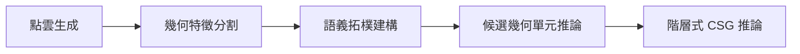

# 研究問題與貢獻：從點雲到可追溯的結構資訊

[首頁](../README.md) · [孔洞端部判別](hole-end-conditions.md) · [拓樸規則例解](topology-rules.md) · [本輪來源與數值](../provenance/research-guides-evidence.json)

本頁依定稿論文第一章、5.2節與現存程式／CSV整理，不增寫論文或研究結果。正式題名為「使用曲面法向量特性與建構式實體幾何法則重塑點雲資料成為實體模型之研究」。研究使用STL生成的點雲與法向量，現行公開成果為CSG推論表示。

## 使用情境與要解決的問題

第一章描述的情境是：既有機械零件缺少CAD圖檔，工程人員需要先整理零件的構件、孔洞、面間關係與尺寸，才能接續參數化建模、再製或設計變更。第五章將本研究定位為這類建模前的結構資訊整理方式；沒有提供實際工廠部署、節省工時或下游CAD自動建模的實測證據。

單一平面或圓柱面描述局部幾何；孔洞、凸台與板件的判定還需要方向、來源面及面間關係。研究將這些中間資訊保存，使最後候選的布林角色能回查其依據。

| 論文1.2節的研究問題 | 方法如何回應 | 可以查看的證據與邊界 |
|---|---|---|
| 如何形成平面／圓柱面群集？ | 依點位置、曲面法向量、既有群集與擬合條件整理面型 | 分割結果、FitResidualMax、NormalConsistencyMin與修正紀錄；四例實作步驟有差異，見[方法對照](method-traceability.md) |
| 如何將群集整理為幾何特徵面？ | 保存面型、方向、中心、參數及ClusterID，再依案例條件整理語義角色 | FaceSummary與[案例範圍](method-scope.md)；面數／軸向／角色條件含案例專屬設定 |
| 如何建立面間關係？ | 比較有限點集的最小距離及代表方向，分為一般相鄰、正交相鄰、端面關係 | TopologyEdges與[判定例解](topology-rules.md)；取樣點距離不等於連續解析曲面的精確邊界距離 |
| 如何由面與關係形成CSG？ | 建立候選幾何單元、保存RelatedClusters與Union／Difference角色，再組成階層表示 | PrimitiveCandidates、CSG JSON與[表示契約](csg-representation.md)；沒有在本入口執行幾何核心的實體布林求值 |

這是論文的五階段閱讀順序；目前自動入口從已提供的點雲／法向量CSV開始，STL／Blender重新取樣未納入本輪重跑。

## 三項研究貢獻與可核對的成果

以下是定稿5.2節的貢獻整理，不宣稱已經由文獻比較證明「首次提出」或優於其他方法。

| 貢獻 | 現存成果 | 讀者可如何查核 |
|---|---|---|
| 連接點級資料、面、關係、候選及CSG的可追溯資料鏈 | ClusterID、FaceSummary、TopologyEdges、PrimitiveCandidates與候選葉節點可相互查對 | 沿[L型板LB_D01導讀](case-walkthrough.md)由候選來源0;2;9回查面與端面關係 |
| 整合面型、面間關係與孔洞端部條件為可檢核規則 | 平面／圓柱擬合、三類拓樸關係、內外法向量及端部支撐規則 | 看[拓樸例解](topology-rules.md)及[BH_D01盲孔判定](hole-end-conditions.md)；共通概念與案例程式差異分開說明 |
| 提供缺少CAD圖檔時的前期結構資訊整理方式 | 四個受控案例能保存構件、孔洞、尺寸及布林角色，供後續建模閱讀 | [既有品質報告](results.md)與[論文圖庫](figures/README.md)可查結果；下游建模效率、CAD實體及製造應用仍未實測 |

研究實作由黃云析完成，指導教授鄭宗明提供研究概念及題目方向；[作者分工](contributions.md)與研究貢獻是不同問題。近期可攜入口、測試、CI與本頁導讀屬作者授權以Codex協助的公開工程整理，沒有回溯宣稱為原論文成果。

## 已有證據能支撐到哪裡

四個STL生成案例涵蓋共軸圓柱、正交板件、多軸特徵與盲孔端部條件。四例的輸出重現、既有研究品質及工程單元測試分別見[查驗](validation.md)、[品質](results.md)及[面試導讀](interview-guide.md)，用途分開：位元一致不等於對任意零件的辨識正確率，軟體fixture也不增加研究案例數。

尚缺的資料：文獻或同資料基準下的優越性證據、真實掃描／未知零件驗證、實際CAD建模與工業效益紀錄，以及部分原始開發決策。這些內容沒有由研究目的或四個指定案例推定為已完成。[完整缺口](missing-information.md)
