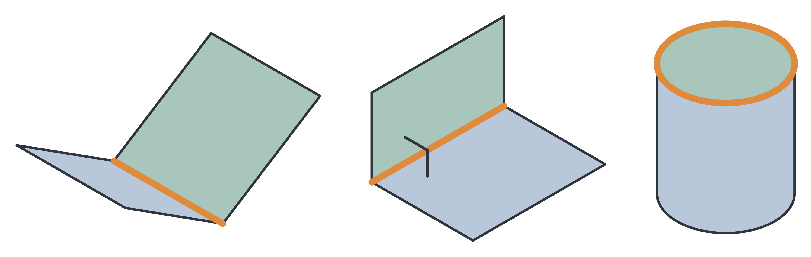

# 三類拓樸關係：判定順序與實際面組

[研究總覽](research-overview.md) · [孔洞端部判別](hole-end-conditions.md) · [公式到實作](method-traceability.md) · [來源與CSV讀回](../provenance/research-guides-evidence.json)

本頁依定稿3.7、4.7.1節，以及目前[共用build_topology](../research/tools/infer_stepped_cylinder_chapter3_method.py#L329)與[L型板版本](../research/tools/infer_lbracket_chapter3_method.py#L321)整理。模型A與盲孔例匯入共用版本；L型板保留本地版本。以下為這些既有案例的Python推論條件，不代表初始C#分類器或任意模型使用相同門檻。

原圖由左至右為一般相鄰、正交相鄰、端面關係；[原圖來源及版面對照](figures/methods.md)。本導讀不改原圖或論文。

## 距離與方向分別描述什麼

原min_distance以cKDTree查兩組**有限取樣點**的最小歐氏距離d；不是兩個無限延伸解析曲面的交線，也不是連續面邊界的精確接觸距離。方向比較使用平面法向量n或圓柱軸a的內積絕對值。

每對面先依幾何類型進入分支，最多記錄一種EdgeType：

| 面組 | 依原程式順序檢查 | 記錄結果 |
|---|---|---|
| 平面／圓柱 | d ≤ 5.0 mm且abs(a·n) > 0.95 | EndCap；此分支先於一般相鄰 |
| 平面／圓柱，未符合EndCap | d ≤ 2.0 mm | Adjacency |
| 平面／平面 | 先要求d ≤ 2.0 mm，再看abs(n1·n2) < 0.2 | 成立為OrthogonalAdjacency，否則為Adjacency |
| 其他面型組合（本範圍內含圓柱／圓柱） | d ≤ 2.0 mm | Adjacency |
| 所屬分支未通過上述條件 | 不建立該面組的邊 | TopologyEdges沒有該筆，不補成第四種關係 |

5.0、2.0、0.95及0.2都是原碼的操作性設定，沒有由本導讀調整或最佳化。EndCap不須先通過2.0 mm一般相鄰門檻；所以程式分支容許2.0 < d ≤ 5.0且方向符合的面組成為EndCap。這是原碼的條件解讀，本頁沒有新增該距離區間的研究案例。

## 三筆可以直接核對的關係

以下保留CSV原顯示精度，三筆均來自既有L型板與盲孔六角座結果：

| 面組 | MinDistance（mm） | DirectionDot | 為何得到該關係 |
|---|---:|---:|---|
| 盲孔六角座1–10 | 0.675950373 | 1.000000000 | 1為圓柱內壁、10為平面，距離與軸／法向量條件符合，記EndCap |
| L型板0–1 | 0.425821353 | 0.000000000 | 兩平面距離≤2.0且方向內積絕對值<0.2，記OrthogonalAdjacency |
| 盲孔六角座3–5 | 0.520761804 | 0.500000010 | 兩個六角側面相近，但不符合正交條件，記Adjacency |

來源：[L型板TopologyEdges](../research/碩士論文/第四章驗證結果_260722/L_Bracket_chapter3_verified_v3/TopologyEdges_L_Bracket_chapter3_verified.csv)、[盲孔TopologyEdges](../research/碩士論文/第四章驗證結果_260725/Blind_Hole_Hex_Base_chapter3_verified_v3/TopologyEdges_Blind_Hole_Hex_Base_chapter3_verified.csv)及[對應面資料](../provenance/research-guides-evidence.json)。這是保存欄位的讀回，沒有重新跑關係辨識。

定稿4.7.1節以正六角側面說明：相鄰側面的外法向量角為60度、內部二面角為120度，因此歸為一般相鄰。CSV的DirectionDot約0.5為**絕對**內積；單憑該欄無法唯一分辨60度與120度，也不能據此推論凸／凹或孔洞的布林角色。

## 互斥關係與後續推論

一對平面／圓柱同時符合一般距離與EndCap時，只記EndCap；兩平面已符合正交時只記OrthogonalAdjacency。這讓關係表保留該分支中較具體的型別，沒有對同一面組重複加一般相鄰邊。

EndCap仍可能對應開口端或封底端；孔洞／外凸台與Union／Difference要再結合內外法向量、語義角色及來源面。見[端部判別導讀](hole-end-conditions.md)。一組相鄰面也不自動等同一個可用候選，後續還有案例組成及連通查驗。

## 待補與不能外推的部分

目前證據是固定資料的面間距離、方向及原程式判準。尚無足以確認一般情形下的拓樸精確率／召回率、邊界缺漏魯棒性或跨尺度最佳門檻的資料；幾何核心的連續邊界鄰接亦未在此實作。這三筆例解不能替代那些驗證，也不能作為未知零件的通用拓樸保證。[資料缺口](missing-information.md)
